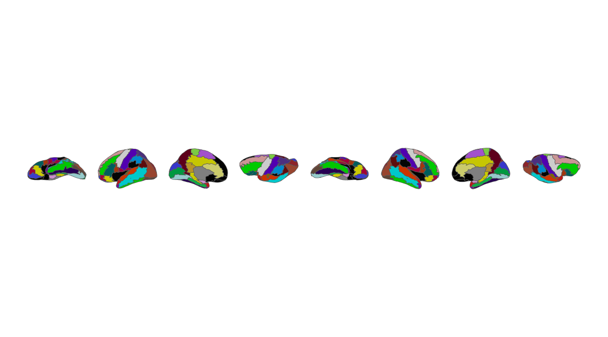
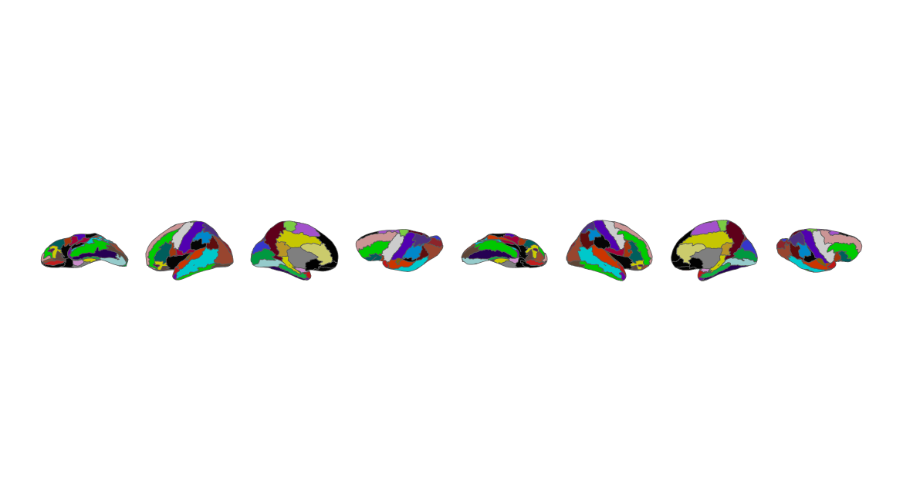
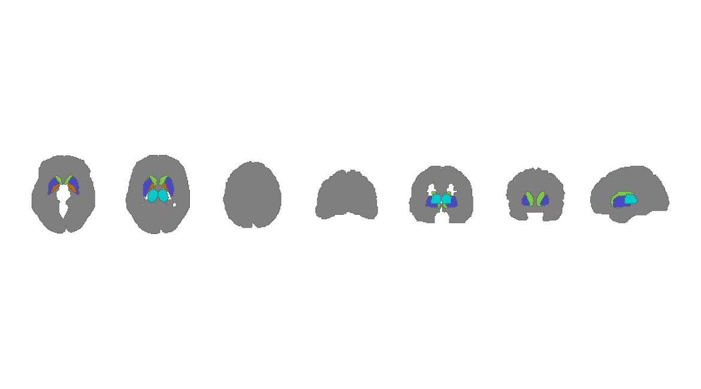
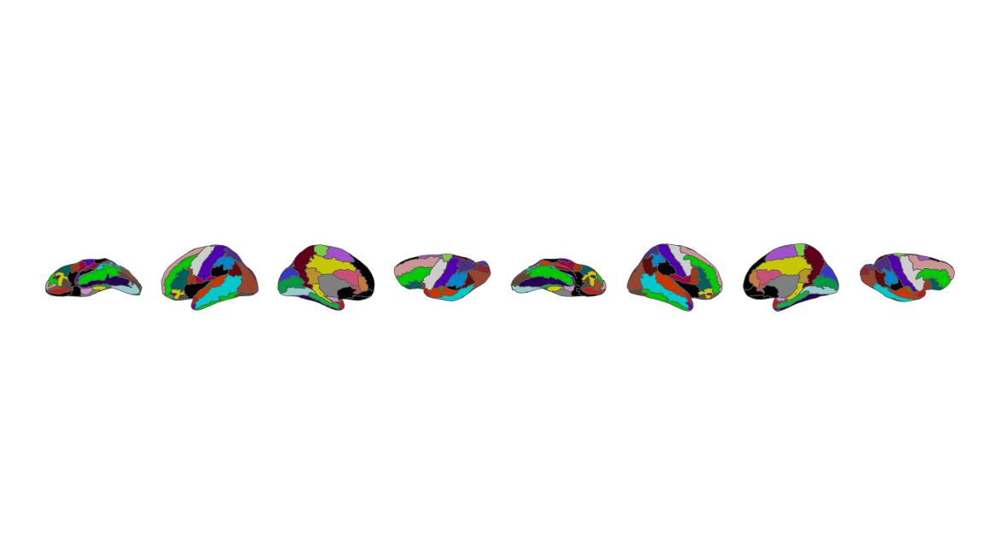
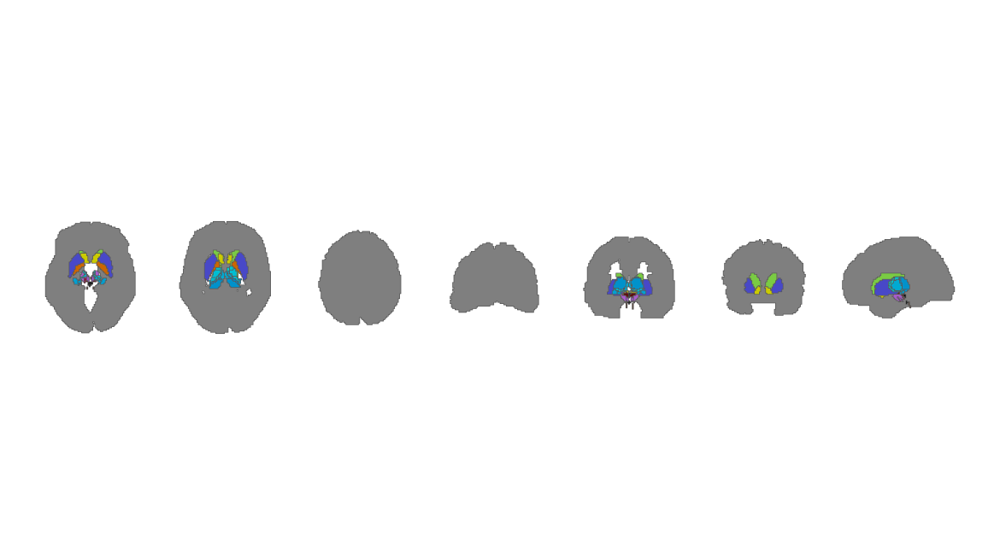
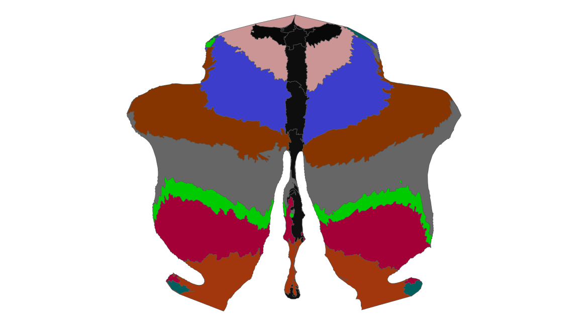

# ggsegAAL

# ggsegAAL

**ggsegAAL** provides cortical, subcortical, and cerebellar
representations of the Automated Anatomical Labeling (AAL) atlas family
for the **ggsegverse** ecosystem. This development version extends the
coverage to nine atlas components spanning AAL1, AAL2, and AAL3, with 2D
and 3D data.

> **Development release (3.0.0).** This repository is a proposed update
> to the [ggsegverse ggsegAal
> package](https://github.com/ggsegverse/ggsegAal), not an official
> ggsegverse release. The geometries and labels may differ from previous
> versions. Compatibility should be checked before replacing an existing
> analysis workflow.

## Installation

Until this version is merged upstream, install it from this development
repository:

``` r

# install.packages("remotes")
remotes::install_github("lemaitreh/ggsegAal")
```

The development repository is
[lemaitreh/ggsegAal](https://github.com/lemaitreh/ggsegAal).

``` r

library(ggsegAAL)
```

## Available atlases

| Atlas | Cortical | Subcortical | Cerebellum | Anatomical regions |
|:---|:---|:---|:---|---:|
| AAL1 | [`aal1_cortical()`](https://lemaitreh.github.io/ggsegAal/reference/aal_atlases.md) | [`aal1_subcortical()`](https://lemaitreh.github.io/ggsegAal/reference/aal_atlases.md) | [`aal1_cerebellum()`](https://lemaitreh.github.io/ggsegAal/reference/aal_atlases.md) | 82 + 8 + 26 = 116 |
| AAL2 | [`aal2_cortical()`](https://lemaitreh.github.io/ggsegAal/reference/aal_atlases.md) | [`aal2_subcortical()`](https://lemaitreh.github.io/ggsegAal/reference/aal_atlases.md) | [`aal2_cerebellum()`](https://lemaitreh.github.io/ggsegAal/reference/aal_atlases.md) | 86 + 8 + 26 = 120 |
| AAL3 | [`aal3_cortical()`](https://lemaitreh.github.io/ggsegAal/reference/aal_atlases.md) | [`aal3_subcortical()`](https://lemaitreh.github.io/ggsegAal/reference/aal_atlases.md) | [`aal3_cerebellum()`](https://lemaitreh.github.io/ggsegAal/reference/aal_atlases.md) | 90 + 50 + 26 = 166 |

The subcortical 2D representations may include a contextual `Cortex`
label; it is *not* counted as an anatomical subcortical region.

## Two-dimensional visualizations

The following calls plot each component. The cortical atlases use
Colin27-based surface representations; cerebellar representations use
SUIT-based geometry.

### AAL1

``` r

library(ggsegAAL)
library(ggseg)
library(ggplot2)

# Apply the original lookup-table colors using the atlas labels.
# Keep the palette names unchanged (including lh_ and rh_ prefixes).
plot_atlas_lut <- function(atlas) {
  pal <- ggseg.formats::atlas_palette(atlas)
  ggplot() +
    ggseg::geom_brain(
      atlas = atlas,
      mapping = aes(fill = label),
      show.legend = FALSE
    ) +
    scale_fill_manual(values = pal, guide = "none") +
    theme_void() +
    theme(legend.position = "none")
}

for (atlas in list(aal1_cortical(), aal1_subcortical(), aal1_cerebellum())) {
  print(plot_atlas_lut(atlas))
}
```



Figure 1: AAL1: cortical, subcortical, and cerebellar components.


Figure 2: AAL1: cortical, subcortical, and cerebellar components.


Figure 3: AAL1: cortical, subcortical, and cerebellar components.

### AAL2

``` r

for (atlas in list(aal2_cortical(), aal2_subcortical(), aal2_cerebellum())) {
  print(plot_atlas_lut(atlas))
}
```



Figure 4: AAL2: cortical, subcortical, and cerebellar components.



Figure 5: AAL2: cortical, subcortical, and cerebellar components.


Figure 6: AAL2: cortical, subcortical, and cerebellar components.

### AAL3

``` r

for (atlas in list(aal3_cortical(), aal3_subcortical(), aal3_cerebellum())) {
  print(plot_atlas_lut(atlas))
}
```



Figure 7: AAL3: cortical, subcortical, and cerebellar components.



Figure 8: AAL3: cortical, subcortical, and cerebellar components.



Figure 9: AAL3: cortical, subcortical, and cerebellar components.

## Three-dimensional visualizations

The
[`ggseg3d_aal()`](https://lemaitreh.github.io/ggsegAal/reference/ggseg3d_aal.md)
helper uses Colin27 inflated meshes for cortical representations and can
add a translucent Colin27 pial surface for anatomical context around
subcortical or cerebellar representations.

``` r

library(ggsegAAL)

ggseg3d_aal(aal3_cortical())

ggseg3d_aal(
  aal3_subcortical(),
  context = TRUE,
  opacity = 0.15
)

ggseg3d_aal(
  aal3_cerebellum(),
  context = TRUE,
  opacity = 0.15
)
```

Interactive 3D widgets are not embedded in this GitHub README; run the
examples above in an interactive R session.

## Compatibility with previous ggsegAAL releases

The original entry points remain available:

``` r

# Original cortical AAL atlas
ggplot() + ggseg::geom_brain(atlas = aal()) + theme_void()

# AAL2 cortical atlas
ggplot() + ggseg::geom_brain(atlas = aal2()) + theme_void()

# Existing AAL3 entry points
for (atlas in list(aal3_cortical(), aal3_subcortical(), aal3_cerebellum())) {
  print(
    ggplot() +
      ggseg::geom_brain(atlas = atlas) +
      theme_void() +
      theme(legend.position = "none")
  )
}
```

Compatibility of **function names** does not guarantee identical vertex
geometry, polygon geometry, color palettes, or region labels across
major versions. Compare outputs before reusing previously derived
region-level results.

## Reproducible construction and quality control

The atlas preparation scripts are available under `data-raw/`. The
distributed package loads previously validated atlas objects; users do
not need FSL or FreeSurfer to run the public accessors.

The package includes structural tests for all nine atlas components and
the expected anatomical region counts. To run checks in the package
source directory:

``` r

# install.packages("devtools")
devtools::test()
devtools::check()
```

## References

- Tzourio-Mazoyer N, et al. (2002). Automated Anatomical Labeling of
  Activations in SPM Using a Macroscopic Anatomical Parcellation of the
  MNI MRI Single-Subject Brain. *NeuroImage*, 15, 273–289.
  [PubMed](https://pubmed.ncbi.nlm.nih.gov/11771995/).
- Rolls ET, Joliot M, Tzourio-Mazoyer N. (2015). Implementation of a new
  parcellation of the orbitofrontal cortex in the automated anatomical
  labeling atlas. *NeuroImage*, 122, 1–5.
  [PubMed](https://pubmed.ncbi.nlm.nih.gov/26241684/).
- Rolls ET, et al. (2020). Automated anatomical labelling atlas 3.
  *NeuroImage*, 206.
  [PubMed](https://pubmed.ncbi.nlm.nih.gov/31521825/).

## Contributing

This is a development implementation intended for review and potential
integration into
[ggsegverse/ggsegAal](https://github.com/ggsegverse/ggsegAal). Please
open issues at
[lemaitreh/ggsegAal](https://github.com/lemaitreh/ggsegAal/issues).
